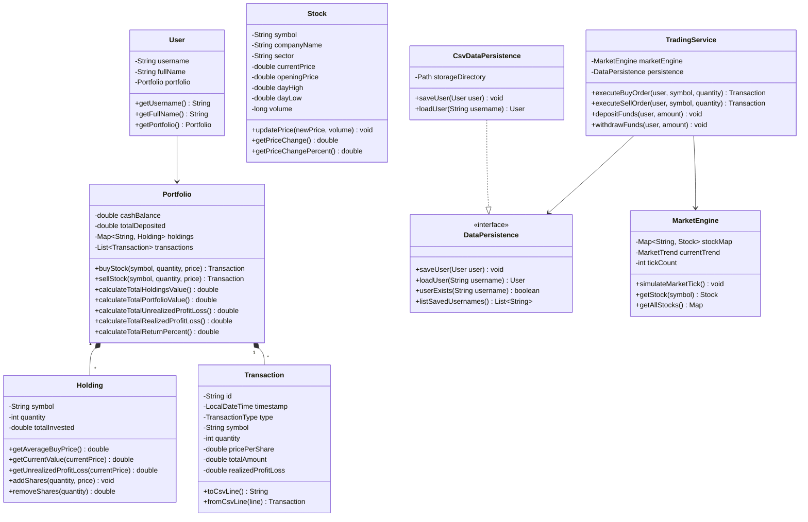

# CodeAlpha Task 2: Stock Trading Platform (Java)

[](https://www.oracle.com/java/)
[](LICENSE)
[](https://www.codealpha.tech/)

A console-based **Stock Trading Simulation Platform** engineered in Java as part of the **CodeAlpha Java Programming Internship (Task 2)**. The platform simulates a live stock market with real-time price fluctuations, executes buy/sell trading orders, calculates portfolio performance and returns, and persists user accounts, holdings, and transaction logs using File I/O.

---

## 📋 Table of Contents
1. [Core Features](#-core-features)
2. [Task Requirements Coverage](#-task-requirements-coverage)
3. [OOP Architecture & Class Design](#-oop-architecture--class-design)
4. [File I/O & Data Persistence](#-file-io--data-persistence)
5. [Project Structure](#-project-structure)
6. [How to Compile and Run](#-how-to-compile-and-run)
7. [User Guide & Interactive Features](#-user-guide--interactive-features)
8. [Automated Test Suite](#-automated-test-suite)

---

## 🌟 Core Features

- **📈 Real-Time Market Simulation**:
  - Pre-loaded with blue-chip stocks across diverse sectors (Apple, Microsoft, NVIDIA, Tesla, Amazon, Alphabet, JPMorgan, etc.).
  - Realistic stochastic price fluctuations (random walk with drift and volatility modeling).
  - Configurable market trends: **Neutral/Steady**, **Bullish Rally**, **Bearish Dip**, and **High Volatility**.
  - Tracks intraday prices, opening prices, price changes (`$`), percentage changes (`%`), day highs, day lows, and trading volume.

- **💹 Order Execution (Buy/Sell Operations)**:
  - **Buy Orders**: Validates stock existence, affordability against available cash, calculates total cost, deducts funds, and updates/creates holdings.
  - **Sell Orders**: Verifies share ownership and quantity, executes at current market price, credits cash proceeds, calculates realized profit/loss, and updates or closes out positions.
  - Real-time order review and user confirmation prompts.

- **💼 Dynamic Portfolio Performance Tracking**:
  - Real-time computation of **Total Portfolio Value** (Available Cash + Active Stock Equity).
  - Position-level metrics: Average buy price, total invested, current market value, unrealized profit/loss (`$`), and unrealized return (`%`).
  - Account-level metrics: Net deposited funds, realized profit/loss, net total profit/loss, and cumulative ROI percentage.

- **📜 Transaction History & Audit Ledger**:
  - Full audit trail recording Transaction ID, timestamp, order type (`BUY` / `SELL`), stock ticker, share quantity, execution price, total dollar value, and realized profit/loss.

- **💾 File I/O Data Persistence**:
  - Auto-saves portfolio states, holdings, and transaction history to structured CSV files in `data/users/` upon every trade.
  - Multi-user support: Seamlessly reload saved trader profiles or switch between accounts.

---

## 🎯 Task Requirements Coverage

| Requirement | Implementation Detail | Status |
| :--- | :--- | :---: |
| **Simulate basic stock trading environment** | `MarketEngine.java` models prices, sectors, daily high/low, and market trends. | ✅ Complete |
| **Market data display & buy/sell operations** | `ConsoleUI.java`, `TradingService.java`, and `Main.java` provide formatted tables & order execution. | ✅ Complete |
| **Track portfolio performance over time** | `Portfolio.java` tracks cash, equity, cost basis, unrealized/realized P&L, and cumulative ROI. | ✅ Complete |
| **Object-Oriented Programming (OOP) principles** | Encapsulation, Abstraction, Polymorphism, and Single Responsibility implemented across packages. | ✅ Complete |
| **File I/O or database logic for persistence** | `DataPersistence.java` interface and `CsvDataPersistence.java` store user profiles, holdings, and transactions. | ✅ Complete |

---

## 🏗 OOP Architecture & Class Design

The project is structured according to clean Object-Oriented design principles and separation of concerns:



### Applied OOP Principles:
1. **Encapsulation**:
   - Internal states of `Stock`, `Holding`, `Portfolio`, and `User` are private. Mutation occurs strictly through validated business methods (e.g. `buyStock()`, `sellStock()`, `updatePrice()`).
2. **Abstraction**:
   - The persistence layer is abstracted behind the `DataPersistence` interface, decoupling the trading logic from storage mechanisms (allowing effortless future migration to SQLite, MySQL, or Mongo).
3. **Polymorphism**:
   - `CsvDataPersistence` implements `DataPersistence`.
4. **Single Responsibility Principle (SRP)**:
   - `MarketEngine` only handles exchange simulation.
   - `Portfolio` only manages financial balances and asset allocations.
   - `CsvDataPersistence` only handles serialization/deserialization.
   - `TradingService` coordinates validation and trade execution.
   - `ConsoleUI` only renders ANSI tables and visual outputs.

---

## 💾 File I/O & Data Persistence

Trader portfolios are stored under the `data/users/` folder:

1. **`{username}_profile.csv`**:
   ```csv
   Username,FullName,CashBalance,TotalDeposited
   alex,Alex Vance,4285.50,10000.00
   ```
2. **`{username}_holdings.csv`**:
   ```csv
   Symbol,Quantity,TotalInvested
   AAPL,15,2730.00
   NVDA,12,1486.80
   TSLA,6,1497.70
   ```
3. **`{username}_transactions.csv`**:
   ```csv
   TransactionId,Timestamp,Type,Symbol,Quantity,PricePerShare,TotalAmount,RealizedProfitLoss
   TXN-A101B202,2026-10-15 09:30:00,BUY,AAPL,15,182.00,2730.00,0.00
   TXN-C303D404,2026-10-15 10:15:30,BUY,NVDA,20,123.90,2478.00,0.00
   TXN-G707H808,2026-10-16 14:45:00,SELL,NVDA,8,131.50,1052.00,60.80
   ```

---

## 📁 Project Structure

```
Stock Trading Platform/
│
├── bin/                                         # Compiled bytecode (.class)
├── data/
│   └── users/                                   # User profiles, holdings, and transactions
│       ├── alex_profile.csv
│       ├── alex_holdings.csv
│       └── alex_transactions.csv
│
├── src/
│   └── com/
│       └── codealpha/
│           └── stocktrading/
│               ├── Main.java                    # Application Entry Point & CLI Loop
│               ├── StockTradingTest.java        # Automated Test Suite (6 test cases)
│               │
│               ├── model/                       # Domain Entities
│               │   ├── Stock.java               # Stock data & intraday metrics
│               │   ├── Holding.java             # Portfolio stock holding
│               │   ├── Transaction.java         # Financial transaction log
│               │   ├── TransactionType.java     # BUY / SELL enum
│               │   ├── Portfolio.java           # Cash, holdings, P&L calculations
│               │   └── User.java                # Trader identity & session
│               │
│               ├── market/                      # Exchange Simulation Engine
│               │   └── MarketEngine.java        # Market ticks, random walk, trends
│               │
│               ├── persistence/                 # Persistence Layer
│               │   ├── DataPersistence.java     # Persistence interface
│               │   └── CsvDataPersistence.java  # CSV File I/O implementation
│               │
│               ├── service/                     # Business Logic
│               │   └── TradingService.java      # Order validation, execution, auto-save
│               │
│               └── util/                        # Display & Formatting
│                   └── ConsoleUI.java           # ANSI colors, ASCII tables, cards
│
├── run.bat                                      # One-click Windows batch launcher
├── run.ps1                                      # PowerShell launcher
└── README.md                                    # Documentation & Submission Guide
```

---

## 🚀 How to Compile and Run

### Option 1: Quick Run via Batch Script (Windows)
Double-click `run.bat` or run in terminal:
```cmd
.\run.bat
```

### Option 2: Quick Run via PowerShell
```powershell
.\run.ps1
```

### Option 3: Manual Compilation & Execution
```bash
# 1. Compile all Java source files
javac -d bin -sourcepath src src/com/codealpha/stocktrading/Main.java src/com/codealpha/stocktrading/model/*.java src/com/codealpha/stocktrading/market/*.java src/com/codealpha/stocktrading/persistence/*.java src/com/codealpha/stocktrading/service/*.java src/com/codealpha/stocktrading/util/*.java

# 2. Run the application
java -cp bin com.codealpha.stocktrading.Main
```

---

## 🖥 User Guide & Interactive Features

When you start the application:
1. **Login or Create Profile**: Choose the demo profile (`@alex`) or enter a new username.
2. **Main Dashboard Menu**:
   ```
   [1]  📈  View Live Market Data & Quotes
   [2]  ⚡  Simulate Market Tick (Price Movements)
   [3]  🟢  Buy Stocks
   [4]  🔴  Sell Stocks
   [5]  💼  View Portfolio Dashboard & Holdings
   [6]  📊  Portfolio Performance & Return Analytics
   [7]  📜  Transaction History & Audit Ledger
   [8]  💵  Deposit / Withdraw Virtual Cash
   [9]  🎯  Change Market Trend / Volatility Simulation
   [10] 💾  Save Portfolio Data Now
   [11] 👤  Switch / Change Trader Profile
   [0]  🚪  Save & Exit
   ```
3. **Simulate Market Price Changes**: Choose Option `[2]` to advance the market by 1 to 20 ticks. Watch how stock prices and portfolio valuations change.
4. **Change Market Sentiment**: Choose Option `[9]` to switch between Bullish Rally, Bearish Dip, or High Volatility conditions.

---

## 🧪 Automated Test Suite

An automated test suite (`StockTradingTest.java`) verifies the core business logic, order execution, cash deductions, P&L calculations, and CSV persistence:

To run the test suite:
```bash
javac -d bin -sourcepath src src/com/codealpha/stocktrading/StockTradingTest.java
java -cp bin com.codealpha.stocktrading.StockTradingTest
```

Expected output:
```
>>> RUNNING CODEALPHA TASK 2 AUTOMATED TEST SUITE <<<
✔ Test 1 Passed: User & Portfolio initialized properly.
✔ Test 2 Passed: MarketEngine initialized with active tickers.
✔ Test 3 Passed: Buy order executed and cash deducted correctly.
✔ Test 4 Passed: Market simulated tick.
✔ Test 5 Passed: Sell order executed and remaining holdings updated.
✔ Test 6 Passed: Full portfolio and transaction history persisted & loaded successfully from CSV!
--------------------------------------------------
Test Results: 6/6 passed.
ALL TESTS PASSED SUCCESSFULLY!
```

---

## 👨‍💻 Developer Information
- **Internship**: CodeAlpha Java Programming Internship
- **Task**: Task 2 — Stock Trading Platform
- **Language**: Java SE (Version 17+)
- **Build Status**: Fully Functional, Tested & Documented
